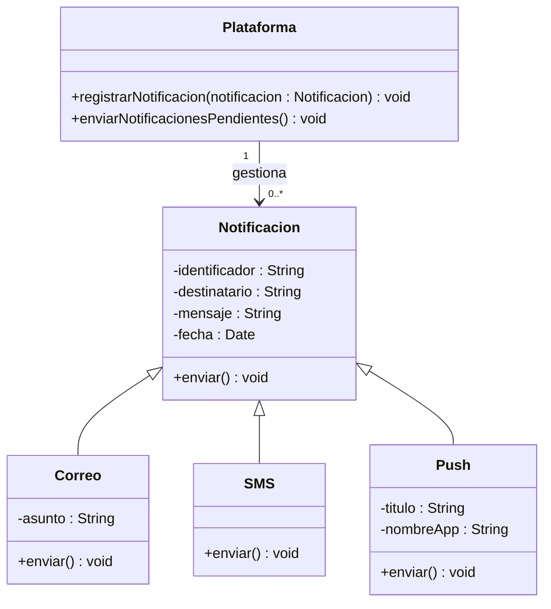
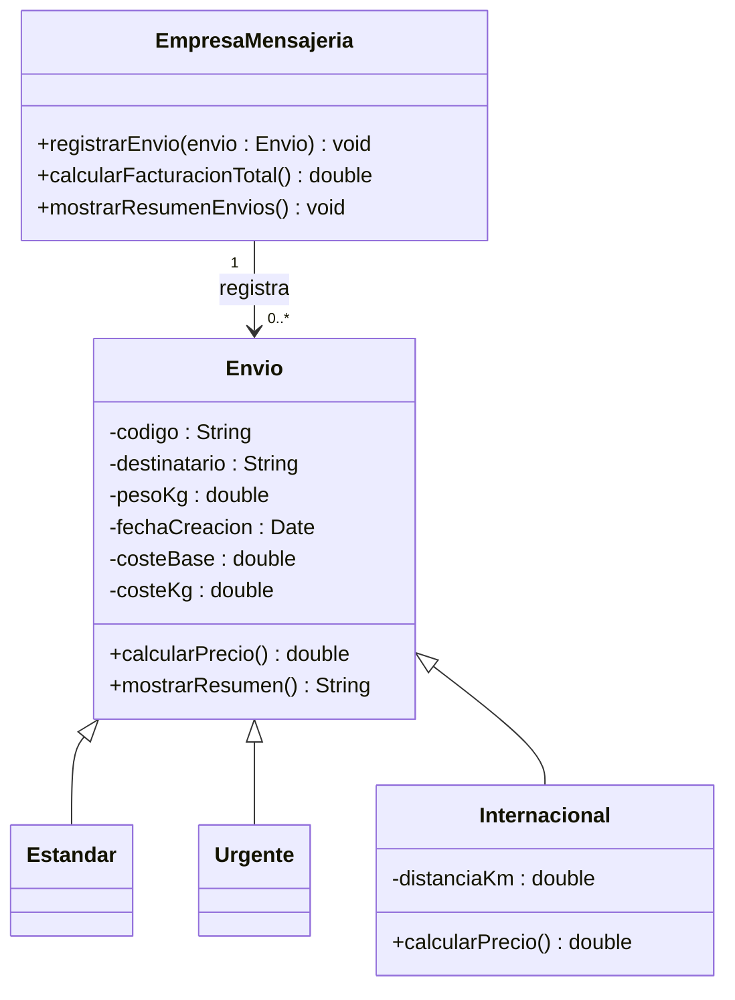

# Diagramas UML — Sesión 13

## Ejercicio 1 — Sistema de notificaciones

La plataforma mantiene notificaciones pendientes y las envía mediante el método
polimórfico `enviar()`. Cada tipo concreto adapta ese método al canal utilizado.

El mensaje de un SMS no puede superar los 160 caracteres. `Plataforma` recorre
las notificaciones pendientes y llama a `enviar()` sin necesitar conocer su
canal concreto.

## Ejercicio 2 — Empresa de paquetería

`Envio` reúne los datos comunes y el cálculo de precio. Las modalidades
configuran sus tarifas; el envío internacional añade la distancia al cálculo.
La empresa gestiona envíos de cualquier modalidad y puede sumar sus precios.

Las tarifas son:

- Estándar: `3 + 0,50 × pesoKg`.
- Urgente: `8 + 1,20 × pesoKg`.
- Internacional: `10 + 2 × pesoKg + 0,01 × distanciaKm`.

El diagrama describe el modelo completo del ejercicio. El código Java del
proyecto `envios-ejercicio` solo contiene una parte de su implementación.
