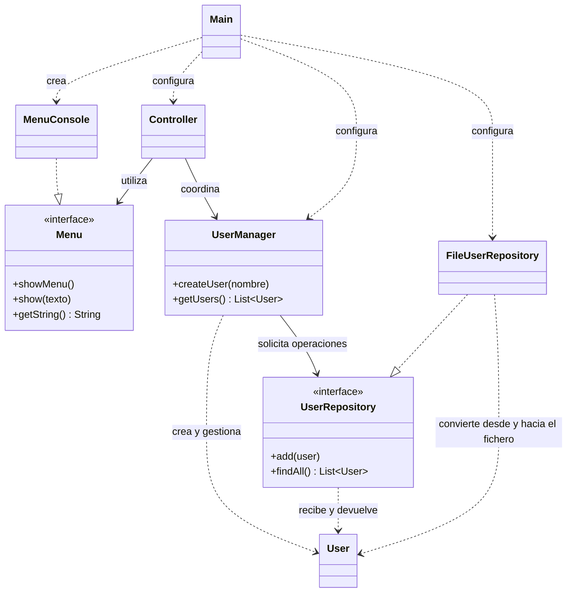

# Sesión 17 — Patrón Repository

## Objetivos

- Explicar qué responsabilidad cumple un Repository en una aplicación sencilla.
- Identificar la diferencia entre el contrato `UserRepository` y su
  implementación `FileUserRepository`.
- Seguir el recorrido de una operación desde la vista hasta el fichero a través
  de las capas de la aplicación.
- Reconocer las clases, interfaces y relaciones principales en el diagrama UML.

## Antes de empezar

Esta sesión continúa la
[arquitectura por capas de la sesión 16](../session-16/README.md), donde se
presentaron las responsabilidades de vista, Controller, gestor y persistencia,
y se compararon DAO y Repository. También se apoya en el uso de
[interfaces de la sesión 15](../session-15/README.md) y en la
[lectura y escritura de ficheros de la sesión 06](../session-06/README.md).

## ¿Qué aporta Repository?

Un Repository ofrece a la aplicación operaciones para trabajar con objetos del
dominio como si fueran una colección, sin exponer cómo se almacenan. En este
ejemplo, `UserManager` puede añadir un usuario y consultar los usuarios mediante
el contrato `UserRepository`; no necesita conocer el formato del fichero.

El contrato se define como una interfaz:

```java
public interface UserRepository {
    void add(User user) throws IOException;

    List<User> findAll() throws IOException;
}
```

- `add` solicita guardar un usuario.
- `findAll` devuelve los usuarios almacenados como una lista.
- `FileUserRepository` implementa estas operaciones usando un fichero de texto.

La interfaz expresa lo que necesita la aplicación; la clase concreta resuelve
cómo satisfacerlo. Así, `UserManager` depende de `UserRepository` y no de las
operaciones de lectura y escritura de `FileUserRepository`. Si cambia el medio
de almacenamiento, puede desarrollarse otra implementación del contrato sin
cambiar la lógica de gestión, siempre que respete sus operaciones.

Este Repository didáctico ofrece únicamente añadir y recuperar todos los
usuarios. No proporciona búsquedas avanzadas, borrado ni las garantías de una
base de datos. En el ejemplo de fichero, cada línea de `users.txt` contiene el
nombre de un usuario.

## Diagrama de clases

El siguiente diagrama resume las clases del ejemplo y sus colaboraciones. Las
flechas discontinuas con triángulo indican que una clase implementa una
interfaz; las flechas continuas indican que una clase utiliza a otra.



Paquetes del código:

| Paquete | Clases |
| --- | --- |
| `views` | `Menu`, `MenuConsole` |
| `controllers` | `Controller` |
| `managers` | `UserManager` |
| `model` | `User` |
| `persistence` | `UserRepository`, `FileUserRepository` |
| Sin paquete | `Main` |

`Main` crea los objetos concretos y los conecta al iniciar el programa. La
vista se pasa al Controller, el gestor al Controller y el Repository al gestor.
De este modo, el Controller puede trabajar con la interfaz `Menu` y el gestor
con la interfaz `UserRepository`, sin conocer sus implementaciones concretas.

## Recorrido del ejemplo

1. `Main` crea un `FileUserRepository` asociado a `users.txt`, un `UserManager`
   y un `Controller` con la vista de consola.
2. `Controller.run()` pide un nombre a `Menu` y delega la creación en
   `UserManager`.
3. `UserManager.createUser()` construye un `User` y llama a `add` en el
   Repository.
4. `FileUserRepository.add()` añade el nombre al final del fichero.
5. El Controller pide los usuarios al gestor; este llama a `findAll`, que lee
   el fichero y devuelve los datos como objetos `User`.
6. La vista muestra la lista resultante.

Si `users.txt` todavía no existe, `findAll` devuelve una lista vacía. Al guardar
el primer usuario, el fichero se crea. En ejecuciones posteriores, los nombres
anteriores se vuelven a leer. Las operaciones de fichero pueden producir
`IOException`, que el ejemplo propaga hasta `main`.

## Ejecutar el ejemplo

Desde el directorio
[`basic-layered-architecture-with-repository`](examples/basic-layered-architecture-with-repository/):

```bash
javac -d out $(find src -name '*.java')
java -cp out Main
```

Introduce un nombre cuando se solicite. Comprueba el contenido de `users.txt` y
vuelve a ejecutar el programa para observar cómo se recuperan los nombres
guardados. Tanto `out/` como `users.txt` son archivos generados al ejecutar el
ejemplo.

## Para reflexionar

- ¿Qué conoce `UserManager` sobre el formato de `users.txt`? ¿Qué clase conoce
  ese detalle?
- ¿Qué tendría que conservar una implementación de Repository distinta para
  poder sustituir a `FileUserRepository` sin cambiar `UserManager`?
- ¿Qué responsabilidad cambiaría si se quisiera guardar los datos en otro
  formato?

## Qué deberías llevarte de esta sesión

- Repository separa las operaciones que necesita la aplicación de los detalles
  del almacenamiento.
- `UserRepository` define el contrato y `FileUserRepository` lo implementa
  usando un fichero.
- `UserManager` trabaja con la interfaz del Repository; la lectura y escritura
  concretas permanecen en la capa de persistencia.
- El diagrama UML permite seguir estas dependencias y entender cómo se conectan
  las clases al iniciar el programa.
